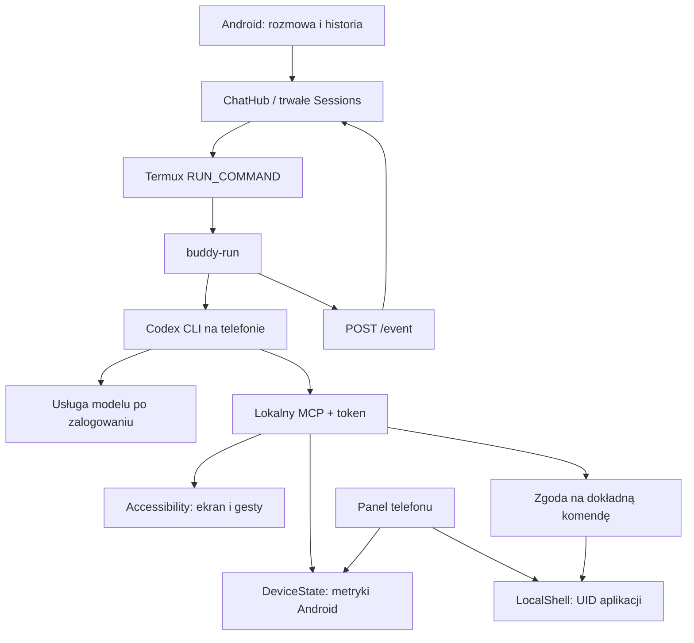

# Architektura androidagent 0.1

## Wybór bazy

Sprawdzono 9 października 2026:

| Projekt | Przydatność | Decyzja |
| --- | --- | --- |
| [Buddy](https://github.com/ghorbelhamdi/buddy-android) | Natywny Android, lokalny MCP, Accessibility, `codex exec`, sesje i załączniki; Apache-2.0 | Baza lokalnego forka, commit `8c69699b1338f3b3c177979bbd0a69140bbdb9ce` |
| [codex-mobile](https://github.com/friuns2/codex-mobile) | UI webowe i most do Codex app-server, wsparcie Termux; MIT | Warto rozważyć protokół app-server w kolejnej iteracji, bez kopiowania kodu w 0.1 |
| [TermFold](https://github.com/Bibarud/TermFold) | Środowisko Debian i agenci w aplikacji Android; Apache-2.0 | Kandydat do wariantu jednego APK z własnym runtime; nie włączono jego kodu |
| [android-codex-bridge](https://github.com/tamir-oss/android-codex-bridge) | Konfiguracja Termux + Shizuku/rish i diagnostyka | Materiał do późniejszej integracji Shizuku, nie gotowa baza interfejsu |
| [OpenAI Codex](https://github.com/openai/codex) | Właściwy klient agenta | Używamy oficjalnego pakietu npm w Termux, nie imitacji modelu |

Wybrano Buddy, bo już łączy lokalnego agenta z narzędziami telefonu. Nowe UI pozostaje natywne, bez WebView i backendu sieciowego projektu. Część ustawień i zaawansowanych ekranów zachowuje angielskie teksty upstream.

## Przepływ

Aplikacja `dev.mateuszsury.androidagent` wymaga Androida 11+, kompilowana jest przeciw API 36. Kod Java i fonty są zawarte w APK; model ani konto nie są wbudowane. Instalacja helpera kopiuje zasoby APK do Termux. Wrapper Codexa wykrywa ARM64 lub x86_64 i mapuje ścieżki DNS/TLS przez proot.

## Najbliższe etapy

1. Pełny test rozmowy z prawdziwym modelem po zalogowaniu właściciela konta oraz test telefonu ARM64. Emulator nie rozstrzyga zgodności różnych producentów.
2. Przejście z `codex exec` do app-server: przyrostowe tokeny, edycja kolejki, bogatsze zatwierdzanie operacji i obsługa zmian plików. Obecny most przekazuje zdarzenia, a tekst odpowiedzi po zakończeniu elementu.
3. Opcjonalny Shizuku UserService z osobnym uprawnieniem i widocznym trybem „Android shell”. Nigdy nie przedstawiać dostępu UID aplikacji jako dostępu shell lub root.
4. Prowadzona instalacja runtime bez ręcznego wklejania poleceń, ewentualnie osobny wariant APK z runtime po weryfikacji TermFold i ograniczeń wykonywania binariów na Androidzie.
5. Pełna lokalizacja, renderowanie Markdown, wyszukiwanie historii, menedżer projektów i przegląd zmian Git.
6. Testy API 33–36, fizycznych urządzeń, dyktowania, ubijania procesów w tle i procesu aktualizacji. Podpis produkcyjny i kanał dystrybucji wymagają osobnej konfiguracji właściciela projektu.
