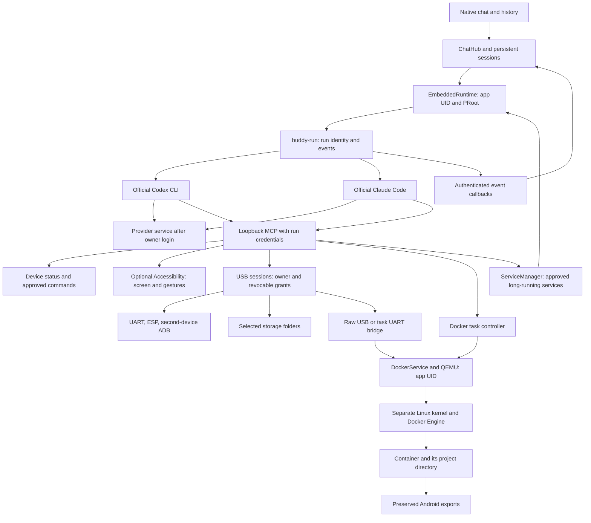

# Architecture

androidagent is a native Java Android application derived from [Buddy](https://github.com/ghorbelhamdi/buddy-android), originally based on commit `8c69699b1338f3b3c177979bbd0a69140bbdb9ce`. It supports Android 11+, targets API 36, and packages ARM64/x86_64 terminal and VM runtimes. The chat UI is native; project web previews use Android WebView.

## Data flow

The current integration does not call an external Termux `RUN_COMMAND` service. Termux packages are extracted into versioned app-private storage; trusted native PRoot and loader entry points preserve their canonical prefix. The persistent home is separate from replaceable runtime files. Provider clients are downloaded from official pinned packages on the device. Account authentication is an explicit owner action.

`buddy-run`, `~/.buddy` and some Buddy class names remain for compatibility. They are internal names, not a dependency on the separate Buddy or Termux applications.

## Boundaries

| Component | Boundary |
| --- | --- |
| App and embedded agents | Android UID and app-private files; no root or other apps' private storage |
| MCP | One listener on `127.0.0.1:8766`; installation or revocable per-run credentials |
| Screen control | Own Accessibility service enabled by the owner; existing services are preserved |
| Commands | MCP `run_command` requires developer mode and exact per-request approval; interactive terminal input is owner initiated |
| Background services | `service_start` requires developer mode and approval of the exact definition; each service is its own PRoot tree outside agent Stop, with its own stop control ([details](SERVICES.md)) |
| Developer mode | Coding clients can access the app UID's whole private environment; PRoot is compatibility, not a security sandbox |
| USB and SAF | Device/tree permission plus assignment to an active conversation run; revocation does not revive old handles |
| Docker | Separate VM kernel, task-owned project mount, no privileged container or agent-visible Docker socket |

Client session IDs, models and histories belong to individual conversations. Changing the default backend only changes new conversations. Event callbacks carry run identity; stale callbacks and Stop requests cannot modify a newer run. Cancellation revokes credentials and ends owned process trees.

## Docker and USB

QEMU TCG boots an Alpine Linux guest with Docker Engine and a persistent QCOW2 overlay. The controller exposes task operations, not a guest administrator shell. Real containerd Version RPC, Docker ping/info, image checks and disk synchronization determine readiness. Revision3 adds bounded per-boot diagnostics and absolute startup deadlines. [Docker details](DOCKER.md).

Native USB modules provide UART/ESP, ADB to another Android device and SAF storage. Raw USB redirects the Android-granted descriptor through libusb/usbredir and QMP to one container device node. UART uses a separate authenticated task bridge. Native and raw-device owners are exclusive. [USB details](USB.md).

## Direction

Current opportunities include Codex app-server integration, broader localization, optional Shizuku UserService, richer project/Git views and more physical-device coverage. These are not implemented features. The embedded setup, project browser, signing and distribution already exist; earlier planning notes are retained only in the [historical snapshot](https://github.com/mateuszsury/androidagent/tree/6f5b3f566a4a85e0e10a5946de3afa55a8079c05/docs).

[Testing](TESTING.md) separates physical Codex/Docker acceptance from unverified Claude account responses and USB hardware. [NOTICE](../NOTICE) and [third-party notices](../THIRD_PARTY_NOTICES.md) record upstream attribution.
