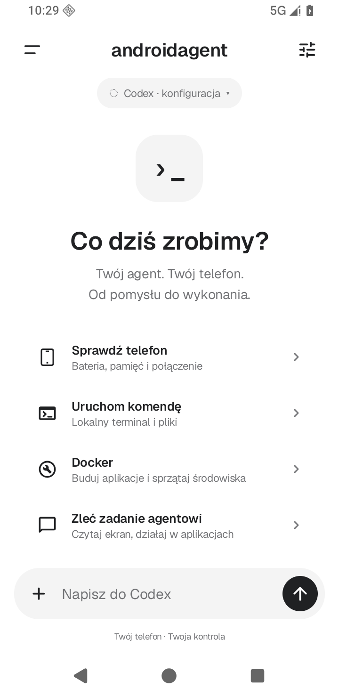
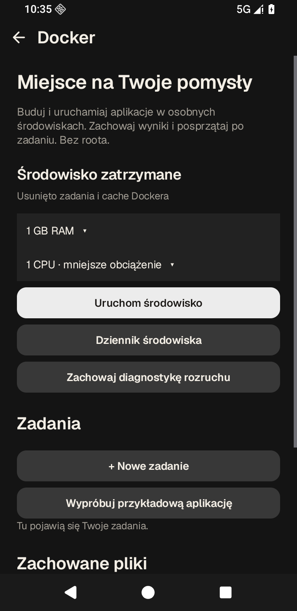
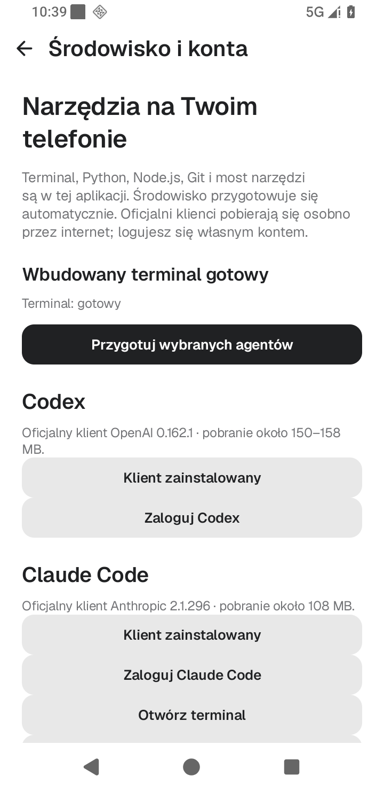
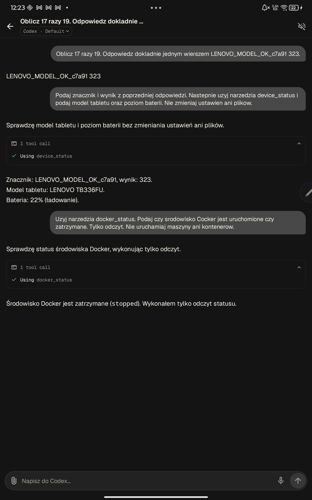
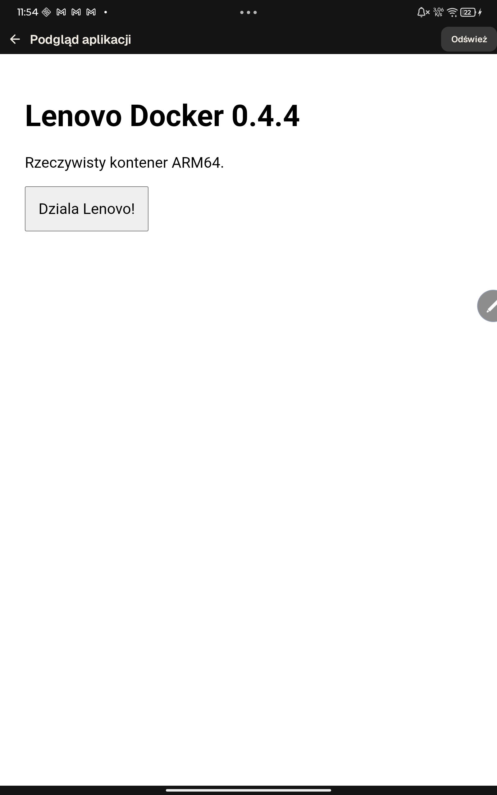

# Screenshots

These are unedited captures of androidagent 0.4.4, not mockups. The current UI includes Polish labels. Screenshots contain test data only; login codes and account credentials are not included.

## Android 16 emulator

| Home | Docker, dark theme | Embedded tools |
| --- | --- | --- |
|  |  |  |

Source: API 36 x86_64 instrumentation against the signed release APK. Home and Docker captures come from the UI suites; the environment screen comes from the clean-install suite without a separate Termux app. These captures demonstrate the interface, not physical ARM execution.

## Physical Lenovo TB336FU

| Real Codex conversation and MCP tools | Interactive page from an ARM Docker container |
| --- | --- |
|  |  |

The Codex capture follows official owner login and shows the test conversation, context preservation and actual status tools. The preview capture follows a real Docker build/run and JavaScript interaction. These are separate test phases. Original images and reports are assets of [Release v0.4.4](https://github.com/mateuszsury/androidagent/releases/tag/v0.4.4).

Provenance: [Testing](TESTING.md). Screenshot changes should retain the original capture, disclose test fixtures and avoid account codes, tokens, personal messages or unrelated applications.
