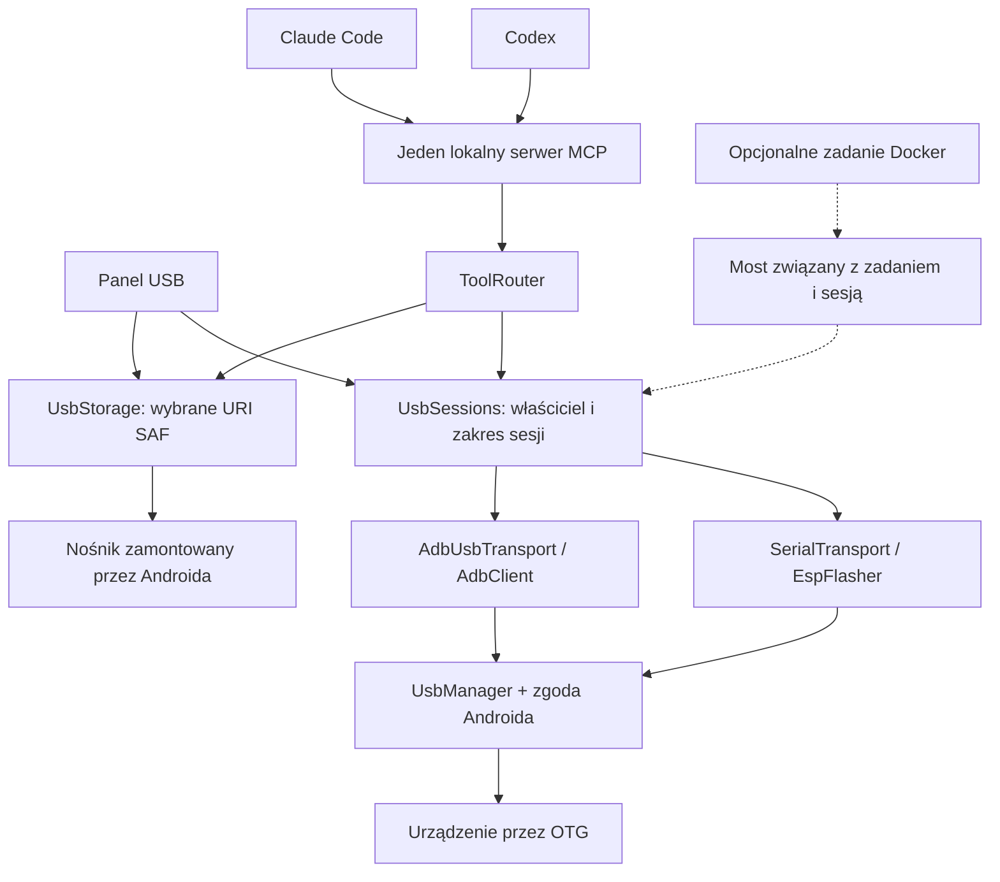

# Plan obsługi USB w androidagent

Status: historyczny plan po wersji 0.3.0, wdrożony programowo w 0.4.0; weryfikacja na fizycznym sprzęcie pozostaje do wykonania. Aktualny kontrakt, sposób użycia i ograniczenia znajdują się w [USB.md](USB.md). Surowe przekazywanie USB do Dockera zostało dodane do zakresu zgodnie z dalszą decyzją użytkownika. Zakres uzgodniony z użytkownikiem: UART/USB-serial i ESP, drugi telefon Android oraz nośniki danych. Podstawowy dostęp działa bezpośrednio w aplikacji, bez roota, Dockera, Termux ani Shizuku. Codex i Claude Code korzystają z tych samych narzędzi MCP. Ich obecne klienty nadal wymagają Termux do uruchomienia agenta; obsługa USB tego wymagania nie rozszerza.

## Stan obecny

W 0.3.0 nie ma obsługi `UsbManager`, zgód USB, transportów do podłączonych urządzeń ani narzędzi MCP USB. Manifest nie deklaruje funkcji USB Host. `-serial stdio` w `DockerVm` oznacza konsolę Linuxa gościa, nie port UART podłączonego urządzenia. VM nie ma przekierowania fizycznego USB. Terminal Androida z UID aplikacji nie zapewnia automatycznego dostępu do `/dev/bus/usb` lub `/dev/ttyUSB*`.

## Obsługiwane scenariusze

| Urządzenie | Bezpośredni dostęp | Pierwsze funkcje | Warunek |
| --- | --- | --- | --- |
| USB-UART / ESP przez adapter albo CDC ACM | Android USB Host + sterownik w aplikacji | Terminal tekst/hex, logi, baud rate, wysyłanie komend, kontrola RTS/DTR | Telefon z USB Host, kabel danych/OTG, zgoda USB |
| ESP | Ten sam transport + port biblioteki flashera | Identyfikacja, firmware z pliku, weryfikacja zapisu i powrót do monitora | Zgodny układ, bootloader i schemat resetu; zakres potwierdzony testami |
| Drugi Android | ADB przez interfejs USB urządzenia docelowego | Stan, shell, logcat, pliki, instalacja APK, uruchomienie aplikacji, diagnostyka | Telefon gospodarza w trybie Host; debugowanie USB i akceptacja klucza na drugim telefonie |
| Pendrive / zewnętrzny dysk | Android montuje nośnik; aplikacja używa Storage Access Framework | Lista plików, odczyt, zapis, kopiowanie i eksport wyników | Obsługiwany przez telefon system plików; użytkownik wybiera katalog |
| Kontener Docker | Opcjonalny most do konkretnej sesji lub kopia plików | Narzędzia projektu mogą korzystać z wcześniej udostępnionego portu lub danych | Włączona VM i osobno przydzielony dostęp |

Obsługa Android USB Host zależy od sprzętu, kabla i zasilania; dyski mogą wymagać aktywnego huba. Dostęp ADB na drugim telefonie ma uprawnienia jego `adbd`/shell, nie roota. Nie odblokowuje prywatnych danych innych aplikacji. Dostępność FAT32, exFAT i innych systemów plików zależy od Androida i producenta. Nie wymagać `MANAGE_EXTERNAL_STORAGE` do katalogu wybranego przez użytkownika.

## Architektura

Wprowadzić `UsbService` z typem pierwszoplanowym `connectedDevice` dla aktywnego połączenia i widocznym powiadomieniem z przyciskiem Stop. Deklaracja `android.hardware.usb.host` ma mieć `required=false`, aby pozostałe funkcje aplikacji działały także bez Host. Zgody i uruchomienie usługi muszą spełniać wymagania API 30–36. Nie uruchamiać usługi automatycznie przy starcie telefonu.

Rozdzielić życie serwera MCP od usługi Accessibility. Obecnie `BuddyService` jest właścicielem MCP i `Tools` ma bezpośrednią zależność od tej usługi. Dodać jeden współdzielony `McpHost` i `ToolRouter`, korzystając z istniejącego `McpServer`, portu 8766 i tokenu instalacji. Panel oraz aktywna usługa USB będą mogły utrzymać dostęp agentów do USB bez włączania Accessibility. Narzędzia gestów zwracają wtedy informację o niedostępności. Nie uruchamiać drugiego serwera na tym samym porcie. Dotychczasowy globalny Stop musi działać również bez Accessibility.

`UsbSessions` zarządza połączeniem i blokadą urządzenia. Jedno urządzenie ma jednego właściciela wykonującego operacje: panel, konkretny agent albo konkretne zadanie Docker. Kolejni obserwatorzy mogą czytać kopię logu, lecz nie otwierają drugiego konkurującego transportu. Pierwsza wersja rezerwuje całe urządzenie; obsługę równoległych interfejsów urządzeń złożonych można rozszerzyć później.

Wspólny token instalacji sam nie rozróżnia rozmów ani obu agentów. Dostęp USB wymaga dodatkowego krótkotrwałego przydziału z losowym poświadczeniem, związanego przez aplikację z konkretnym uruchomieniem klienta. Helper przekazuje je właściwemu wywołaniu; serwer sprawdza przydział i nie ufa nazwie agenta podanej w argumentach. Publiczny stan sesji nie ujawnia poświadczenia. Anulowanie rozmowy odbiera jej dostęp, a globalny Stop odbiera wszystkie przydziały.

Odłączenie, odebranie dostępu, zakończenie procesu i globalny Stop anulują kolejkę, zamykają transport i unieważniają identyfikator sesji. Po ponownym podłączeniu powstaje nowa generacja identyfikatora; nie wznawiać automatycznie komendy na podstawie samych VID/PID. Dwa identyczne adaptery muszą być rozróżniane. Zgoda Androida na urządzenie jest osobna od przydzielenia sesji agentowi.

## Etapy implementacji

### 1 Podstawy USB i wspólny dostęp agentów

Dodać `UsbActivity`, `UsbService`, `UsbDevices`, `UsbSessions`, `UsbTools`, `McpHost` i `ToolRouter`. Panel pokazuje wykryte urządzenia, VID/PID, interfejsy, obsługiwane profile, stan zgody i właściciela połączenia. Nazwa i numer seryjny mogą być niedostępne przed zgodą. Żądanie zgody otwiera użytkownik z panelu; agent otrzymuje stan `permission_required`. Obsłużyć attach/detach, odmowę, timeout, zajęte urządzenie, anulowanie i zmianę konfiguracji Activity. Ustawienia pozwalają udostępnić wybrane urządzenie agentowi na czas sesji oraz odebrać dostęp.

Kryterium zakończenia: jeden serwer MCP, dostęp do modułu USB bez Accessibility, prawidłowe odmowy i Stop oraz brak regresji istniejących narzędzi. Działanie bez uruchomionej VM jest osobnym obowiązkowym przypadkiem testowym.

### 2 UART i USB serial

Zintegrować `usb-serial-for-android` 3.11.0, przypiąć tag/commit i sumę pobranego źródła. Biblioteka ma licencję MIT i sterowniki Java, bez roota: FTDI, CP210x, CH340/CH341, PL2303 i CDC ACM. Nie utożsamiać samej nazwy producenta z kompatybilnością każdego modelu. Uwzględnić wiele portów adaptera i wybór interfejsu.

Dodać terminal UTF-8/hex, wybór parametrów, liczniki RX/TX, ograniczony bufor logu z kursorem odczytu, zapis logu, ustawienia końca linii i operacje RTS/DTR. Odczyt z agenta i panelu korzysta z jednego odbiornika, aby nie gubić danych przez konkurujące odczyty. Odczyty mają skończony timeout, zapisy raportują liczbę faktycznie wysłanych bajtów. Nie przedstawiać timeoutu jako odłączenia.

Otwarcie i inicjalizacja adaptera mogą zmienić linie sterujące. Użytkownik powinien widzieć wybrany profil oraz zachowanie resetu; sam podgląd logów nie może uruchamiać automatycznych sekwencji resetowania ESP. Po przydzieleniu sesji terminalowej nie wymagać kolejnej zgody na każdy pakiet.

Kryterium zakończenia: fizyczny loopback oraz rozmowa z ESP przez adapter CP210x/CH340 i przez obsługiwany CDC, z poprawnym odłączeniem podczas I/O.

### 3 Bezpośrednia obsługa ESP

Wykonać krótki test portu `espressif/esp-serial-flasher` (Apache-2.0). To biblioteka C z możliwością własnej platformy; Android wymaga nowego portu I/O i integracji JNI, nie gotowego upstreamowego sterownika Androida. Pakować małą bibliotekę dla ARM64 i x86_64. Komunikację realizować przez istniejącą sesję serial: zapis/odczyt, czas, zmiana prędkości oraz uzgodniona sekwencja boot/reset. Nie wymagać Pythona, Termux lub Dockera do wgrania gotowego firmware'u.

Przygotować odtwarzalny build JNI przez Android NDK/CMake i włączyć jego wynik zarówno do ścieżki Gradle, jak i `tools/build-local.sh`. Przypiąć źródła oraz dołączyć licencje biblioteki i ewentualnych stubów. Przed integracją sprawdzić możliwość anulowania I/O i wymagane funkcje dla konkretnego wariantu ESP.

Pierwszy zakres: identyfikacja układu, odczyt informacji o zabezpieczeniach, wskazany plik lub zestaw segmentów `.bin`, jawne offsety, kontrola zgodności i rozmiaru, postęp zapisu, weryfikacja wspierana przez target, reset oraz powrót do monitora. `flash` otrzymuje identyfikator operacji. Zapis ma obejmować konkretne urządzenie, artefakt z SHA256 i mapę segmentów. Odłączenie lub przerwanie nie oznacza udanego ani cofniętego programowania; wskazać stan i możliwość ponownego wgrania.

Kompilacja firmware'u jest osobną funkcją: można użyć odpowiedniego toolchainu w Termux, opcjonalnego Dockera albo zaimportować plik. Nie obiecywać wbudowanego ESP-IDF/Arduino toolchainu w tym etapie. Nie udostępniać programowania eFuse, zmiany secure boot ani odblokowania zabezpieczeń jako zwykłych komend flashera.

Kryterium zakończenia: identyfikacja i wgranie jawnego testowego firmware'u na fizycznym ESP32 przez adapter oraz na wybranym ESP32 z USB CDC, z weryfikacją i odczytem logu po restarcie. Lista wspieranych wariantów wynika z testów, nie z pełnej macierzy biblioteki.

### 4 Drugi telefon Android przez ADB

Dodać `AdbUsbTransport` wykorzystujący interfejs ADB oraz endpointy bulk, a także `AdbClient`. Warstwę protokołu oprzeć na specyfikacji AOSP. Przed wyborem biblioteki sprawdzić współczesne AUTH, negocjację rozmiaru pakietów, `shell_v2`, sync i anulowanie. `AdbLib` oraz `libadb-android` są materiałem do ponownego użycia, ale ich dokumentacja dotyczy transportu sieciowego; nie uznawać ich za gotową implementację USB. Pierwszy prototyp ma rozstrzygnąć zakres adaptacji przed dodaniem zależności.

Klucz ADB przechowywać lokalnie w aplikacji, osobno od kont modeli. Zgoda USB na telefonie gospodarza i zgoda RSA na telefonie docelowym to dwa osobne kroki. Połączenie musi odróżniać `permission_required`, `unauthorized`, `offline` i `connected`. Nie wymagać bezprzewodowego ADB do działania po kablu.

Pierwsze operacje: `getprop`/diagnostyka, shell z stdout/stderr i kodem wyjścia tam, gdzie target wspiera `shell_v2`, filtrowany logcat, push/pull z postępem i limitem, instalacja wskazanego APK, uruchomienie i zatrzymanie aplikacji. Docelowo dodać screenshot, sterowanie przez `input`/UIAutomator oraz forward do debugowania własnej aplikacji, z uwzględnieniem ograniczeń targetu. Polecenia trzeba wykonywać na jawnie wskazanym drugim telefonie; UI i wynik zawsze pokazują urządzenie oraz uprawnienia shell. Zgoda na sesję określa zakres; instalacja lub komenda zmieniająca stan nie dziedziczy zgody z samego podglądu logów.

Kryterium zakończenia: dwa fizyczne telefony, akceptacja i odmowa AUTH, prawdziwy logcat i shell, plik z porównaniem SHA256, instalacja testowego APK i odłączenie podczas transferu. Fastboot i odblokowanie bootloadera są osobnym przyszłym zakresem.

### 5 Nośniki danych

Dodać `UsbStorage` i panel katalogu przez `ACTION_OPEN_DOCUMENT_TREE`, `DocumentsContract` oraz `ContentResolver`. Zapisywać tylko uprawnienia read/write faktycznie udzielone przez system; utrwalać URI, gdy provider na to pozwala. USB permission nie daje automatycznie dostępu SAF i odwrotnie. Agent otrzymuje wewnętrzny identyfikator katalogu i dokumentów, nie dowolny URI lub ścieżkę telefonu.

Udostępnić stronicowaną listę i metadane, odczyt tekstu/binarny, tworzenie plików, strumieniowe kopiowanie, postęp, anulowanie i sprawdzenie sumy. Duże pliki importować do katalogu projektu lub eksportować z zachowanych wyników aplikacji, bez kodowania całej zawartości w wiadomości MCP. Weryfikować faktyczne możliwości providera, wolne miejsce i ewentualny limit rozmiaru pliku, np. FAT32. Nadpisanie lub usunięcie ma dotyczyć wyraźnie wskazanego pliku; nie wynika ze zgody na odczyt katalogu.

Odłączenie pozostawia błąd `media_unavailable` i informację o ewentualnym częściowym zapisie. SAF nie gwarantuje atomowego rename ani transakcyjnego zapisu na każdym providerze. Nie podawać sukcesu przed zakończeniem transferu. Ponowne podłączenie wymaga sprawdzenia ważności URI i dostępności nośnika. Nie każdy provider pozwala wiarygodnie powiązać katalog z konkretnym VID/PID; nie oznaczać niepotwierdzonego katalogu jako konkretnego pendrive'a.

Nie przejmować interfejsu mass-storage nośnika zamontowanego przez Androida. Własny sterownik blokowy lub obsługa systemów plików, których Android nie montuje, wymaga osobnego zakresu i testów. Pierwsza wersja nie formatuje nośników i nie zapisuje surowych sektorów.

Kryterium zakończenia: prawdziwy pendrive FAT32 oraz nośnik exFAT na telefonie, który go obsługuje; kopiowanie i odczyt binarny z SHA256, readonly, odmowa katalogu, odebranie URI i odłączenie podczas zapisu.

### 6 Opcjonalne narzędzia i Docker

Bezpośredni panel i MCP pozostają pełną ścieżką dla powyższych operacji. Opcjonalny adapter narzędzi udostępnia jednej sesji właściwy transport. Dla serial potrzebny jest protokół obejmujący również baud rate, RTS/DTR i break; sam TCP z bajtami nie wystarcza np. do automatycznego wejścia ESP w bootloader. Dla ADB most musi implementować wybraną usługę/protokół, a nie udawać lokalne `/dev/bus/usb`.

Zadanie Docker otrzymuje wyłącznie uprawnienie do wybranej sesji. Połączenie z gościa do aplikacji wymaga uwierzytelnienia i trasy zweryfikowanej dla QEMU user networking; `127.0.0.1` w kontenerze nie jest telefonem. Token ma być krótko żyjący i związany z zadaniem, bez tokenu całego MCP oraz klucza ADB. Zakończenie sesji, Stop lub cleanup zadania odbierają dostęp. Dla nośnika preferować import/eksport plików; nie montować Androidowych URI jako linuksowych ścieżek.

Surowe przekierowanie USB do QEMU jest osobnym badaniem. `libusb_wrap_sys_device` pozwala natywnemu kodowi aplikacji wykorzystać descriptor uzyskany po zgodzie Androida, lecz nie zapewnia automatycznie przekazania USB do stockowego QEMU lub kontenera. Nie uzależniać pierwszych pięciu etapów od tej funkcji.

## Proponowany kontrakt MCP

Nazwy poniżej są planowanym API, nie listą narzędzi istniejącej wersji. Dostęp wymaga uwierzytelnienia MCP oraz odpowiedniego przydziału sesji USB lub katalogu. Dane binarne mają jawne kodowanie. Odpowiedzi odróżniają timeout, odłączenie, brak zgody, anulowanie i błąd operacji.

| Grupa | Narzędzia | Ograniczenie |
| --- | --- | --- |
| Urządzenia | `usb_devices`, `usb_open`, `usb_status`, `usb_close` | Otwarcie po zgodzie systemowej, identyfikator z generacją połączenia |
| Serial | `usb_serial_configure`, `usb_serial_read`, `usb_serial_write`, `usb_serial_control` | Wybrany port, skończony timeout i limit danych; log czytany kursorem |
| ESP | `esp_info`, `esp_flash` | Wybrany artefakt i mapa segmentów; flash jako operacja asynchroniczna |
| ADB | `adb_status`, `adb_exec`, `adb_logcat`, `adb_push`, `adb_pull`, `adb_install` | Jawny target i zakres sesji; większe wyniki jako artefakty |
| Nośniki | `usb_storage_roots`, `usb_storage_list`, `usb_storage_read`, `usb_storage_write`, `usb_storage_copy`, `usb_storage_delete` | Wyłącznie przyznane katalogi i faktyczne możliwości providera |
| Operacje | `usb_job_status`, `usb_job_cancel` | Postęp, kod wyniku, częściowe wykonanie; powiązanie z właścicielem |

Uzupełnić instrukcję obu agentów i instalator helpera. Wyjście urządzenia i nazwy plików są danymi diagnostycznymi; nie rozszerzają przydzielonych uprawnień. Logi i artefakty muszą mieć ograniczenia rozmiaru. Parametry i surowe endpointy są sprawdzane także po stronie aplikacji, nie tylko w instrukcji modelu.

## Weryfikacja i warunek wydania

Na emulatorze sprawdzić panel, oba motywy, rotację, kolejki, timeout, Stop, właścicieli sesji, MCP obu agentów, brak uruchomionej VM oraz działanie USB bez Accessibility. Testowy transport jest jawnie oznaczonym fixture. Protokół ADB sprawdzić także z rzeczywistym `adbd` emulatora przez transport TCP; to nie zastępuje testu transportu USB. SAF sprawdzić przez testowego `DocumentsProvider` z odmową, readonly, nieznanym rozmiarem i częściowym zapisem.

Na fizycznym telefonie ARM64 przetestować systemowe zgody i realne OTG: loopback USB-UART, ESP, drugi telefon i pendrive. Minimalny zestaw sprzętu: adapter CP210x lub CH340, ESP z obsługiwanym CDC, drugi Android oraz nośnik FAT32/exFAT. Użyć bezprzewodowego ADB wyłącznie do testowania telefonu gospodarza, gdy port zajmuje OTG. Raport sprzętowy powinien zawierać model gospodarza, Android/API, identyfikatory urządzeń, sterownik, SHA256 APK oraz rzeczywiste wyniki.

Przed wydaniem powtórzyć obecne testy aplikacji, Termux i Dockera w zakresie zmian wspólnego MCP oraz globalnego Stop. Weryfikacja pozostaje bez zalogowanych modeli zgodnie z decyzją użytkownika. Emulator nie stanowi dowodu zasilania magistrali, obsługi kabla ani zgodności sterownika z fizycznym urządzeniem. Wydanie deklaruje tylko przetestowane profile sprzętowe.

## Źródła techniczne

Sprawdzone 10 października 2026:

- [Android USB Host](https://developer.android.com/develop/connectivity/usb/host): API, zgoda na urządzenie i attach/detach.
- [USB Host i Accessory](https://developer.android.com/develop/connectivity/usb): role USB, sprzęt i debugowanie gospodarza.
- [usb-serial-for-android 3.11.0](https://github.com/mik3y/usb-serial-for-android/releases/tag/3.11.0) oraz [licencja MIT](https://github.com/mik3y/usb-serial-for-android/blob/master/LICENSE.txt): sterowniki użytkowe Java.
- [ESP Serial Flasher](https://github.com/espressif/esp-serial-flasher) oraz [licencja Apache-2.0](https://github.com/espressif/esp-serial-flasher/blob/master/LICENSE): funkcje, zgodność targetów i port własnej platformy.
- [Protokół ADB w AOSP](https://android.googlesource.com/platform/packages/modules/adb/+/refs/heads/main/docs/dev/protocol.md): ramki, AUTH i strumienie.
- [AdbLib](https://github.com/cgutman/AdbLib) i [LibADB Android](https://github.com/MuntashirAkon/libadb-android): kandydaci do warstwy protokołu, nie potwierdzone transporty USB.
- [Storage Access Framework](https://developer.android.com/training/data-storage/shared/documents-files): zakres URI, uprawnienia i możliwości providerów.
- [Foreground service types](https://developer.android.com/develop/background-work/services/fgs/service-types): `connectedDevice` i warunki uruchomienia.
- [libusb na Androidzie](https://github.com/libusb/libusb/blob/master/android/README) i [USB w QEMU](https://www.qemu.org/docs/master/system/devices/usb.html): natywny descriptor oraz osobne wymagania przekierowania do VM.
